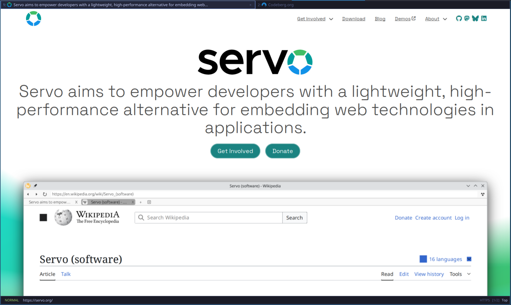

# Neoweb

> A lightweight, keyboard-driven, modal web browser inspired by [Luakit](https://github.com/luakit/luakit), built in Rust using the [Servo](https://servo.org/) browser engine and the [Iced](https://iced.rs/) GUI toolkit, fully scriptable and configurable via LuaJIT.



[](https://www.rust-lang.org/)
[](https://servo.org/)
[](https://iced.rs/)
[](https://luajit.org/)
[](https://wayland.freedesktop.org/)

---

## Overview

**Neoweb** reimagines Luakit's keyboard-centric, vi-style modal browsing model with a modern, memory-safe, and modular Rust foundation:

- **Embeds Servo**: Production-grade web rendering with Stylo/Taffy layout, WebRender GPU pipeline, SpiderMonkey (`mozjs`) JavaScript engine, and W3C WebDriver BiDi automation.
- **Iced GUI Shell**: Wayland-native windowing with offscreen WGPU texture composition and declarative Elm-architecture UI widgets.
- **Lua-First Architecture**: Lua is the authoritative single source of truth for browser modes, session history, UI layout AST generation, and keybinding dispatch. Rust contains zero shadow state or fallback UI widgets.
- **Neovim Standard Notation**: Strict adherence to Neovim key notation (`<CR>`, `<BS>`, `<Esc>`, `<Space>`, `<Tab>`, `<S-Tab>`, `<C-w>`, `<C-u>`, `<C-o>`, `<C-i>`, `<C-n>`, `<C-p>`).
- **Wayland-Exclusive**: Engineered specifically for modern Wayland compositors (Sway, Hyprland, GNOME Wayland, KDE Plasma Wayland, River). X11 is strictly out of scope.

---

## Architecture

Neoweb strictly enforces architectural decoupling across four modular tiers:

```
┌────────────────────────────────────────────────────────────────────────┐
│                        1. Scripting Layer (Lua)                        │
│   lua/init.lua • lib/modes.lua • lib/binds.lua • lib/ui/*.lua          │
│   (Authoritative state machine; declarative UI AST; session manager)   │
└───────────────────────────────────┬────────────────────────────────────┘
                                    │ mlua FFI / MPSC Event Bus
┌───────────────────────────────────▼────────────────────────────────────┐
│                    2. GUI Host Shell (Rust / Iced)                     │
│   - Wayland Windowing (winit / raw-window-handle)                      │
│   - Modal Input Precedence (Key router -> Lua dispatch)                │
│   - Dynamic UI Renderer (src/ui/lua_view.rs via Lua AST)               │
│   - Viewport Texture Renderer (iced::widget::shader / WGPU surface)    │
└───────────────────────────────────┬────────────────────────────────────┘
                                    │ WebEngine Trait / Embedder APIs
┌───────────────────────────────────▼────────────────────────────────────┐
│                 3. Embedder Glue Layer (src/engine/servo/)              │
│   - ServoHost & EventLoopWaker integration                             │
│   - surfman OpenGL / EGL context manager & WebRender bridge            │
│   - Chromium-style NavigationEntry linear session history              │
│   - W3C WebDriver BiDi Command Dispatcher                              │
└───────────────────────────────────┬────────────────────────────────────┘
                                    │ IPC Channel / Constellation Msg
┌───────────────────────────────────▼────────────────────────────────────┐
│                     4. Servo Engine Core Pipeline                      │
│   - Constellation Coordinator & Hang Monitor                           │
│   - Stylo / Taffy Layout Threads (layout_threads: 3)                   │
│   - SpiderMonkey JavaScript Runtime (mozjs / js_jit enabled)           │
│   - Isolated Content Processes (multiprocess IPC tokens)               │
└────────────────────────────────────────────────────────────────────────┘
```

---

## Key Features & Design Decisions

### 1. Neovim-Style Modal State Machine
- Dynamic mode registration handled entirely in Lua via `modes.new_mode(name, spec)`.
- Core modes:
  - `normal`: Vi-style page navigation (`j`/`k`/`h`/`l`, `d`, `r`, `t`, `o`, `y`, `p`, `<C-o>`, `<C-i>`, `f`, `F`).
  - `command`: Command prompt (`:`) overlapping the status bar at the bottom, matching Neovim's `:ex` layout.
  - `search`: In-page forward (`/`) and backward (`?`) search with `n`/`N` navigation.
  - `insert`: Keystrokes pass directly to web content `<input>` and `<textarea>` elements; exit with `<Esc>`.
  - `passthrough`: Bypass all modal key interception (`<C-z>`); exit with `<Esc>`.
  - `follow`: Mouseless link navigation overlay with alphanumeric hints (`f` in current tab, `F` in new tab).
- History navigation: `<C-o>` (back) and `<C-i>` (forward) with numeric count prefix support (e.g. `2<C-o>`).

### 2. Tab Strip & Dynamic Visual Feedback
- **Strict 28px Height**: Tab bar and tab pills remain strictly 28px (`height = 28`, `max_height = 28`, `overflow = "clip"`, no vertical wrapping), completely eliminating layout jitter.
- **Dynamic Multi-Byte UTF-8 Truncation**: Tab title width is calculated dynamically from available horizontal space (`tab_tile_width - non_title_width`), truncated safely with multi-byte UTF-8 awareness (`utf8_len`, `utf8_truncate`) and appended with `"..."`.
- **Chrome-Style Close Button (`×`)**:
  - Rendered **only on the active/focused tab**. Inactive tabs hide the close button, maximizing title readability.
  - Sized strictly 16×16px (identical to favicon dimensions) with rounded hover corners (`radius: 3.0`) so hover highlights fit cleanly inside the 28px pill without overflow.
  - Perfectly centered horizontally and vertically inside its button container.
- **Favicons & Vector Loading Spinner**:
  - Multi-format favicon loader supporting `.ico`, `.png`, `.svg` (via `resvg`), `.webp`, and `data:` URIs with GPU texture caching.
  - Displays an animated vector spinner (`iced_aw::Spinner`) during provisional and committed page loading until the load completes.
  - Built-in raster icons for `about:neoweb`, `about:blank`, and `about:help` to eliminate missing font glyph boxes on Wayland compositors.

### 3. Completion Menus & Interactive Lists
- **Strict Left-Alignment**: Completion popups and item list rows are strictly left-aligned (`Alignment::Start`) with a fixed 160px command/label column and `wrapping = "none"`, ensuring crisp tabular layout.
- **Zero Marker Noise**: Prefix markers (`▶ ` / `  `) are eliminated. Active selection is indicated solely through row background color (`BG_ACTIVE`) and text color highlights (yellow title, primary description), avoiding font glyph width misalignment.
- **Neovim Cycling & Editing**:
  - Suggestion cycling via `<Tab>` / `<C-n>` (next) and `<S-Tab>` / `<C-p>` (previous).
  - Command-line editing with `<C-w>` (delete previous word) and `<C-u>` (clear line).

### 4. Session History & Tab Persistence
- **Chromium-Style `NavigationEntry`**: Linear session history (`Vec<NavigationEntry>`) with active `current_index`. Traversing history with `<C-o>` / `<C-i>` immediately displays cached titles for zero-latency, zero-flicker feedback during provisional loads.
- **Pure-Lua Session Manager (`lua/lib/session.lua`)**:
  - Save and restore window tabs and active tab indices.
  - Commands: `:session save|restore|list|delete [name]`, `:w [name]`, `:wq [name]`, `:x`.
  - Automatic session restoration on launch when no CLI URL is provided.
  - Persistent JSON storage in `~/.config/neoweb/session.json` and `~/.config/neoweb/sessions/<name>.json`.

### 5. Bookmarks & Browsing History
- **Chromium-Compatible Bookmarks**: Bookmarks are stored in standard Chromium JSON tree format at `~/.config/neoweb/Bookmarks`.
- **Append-Only History**: Browsing history is persisted in SQLite at `~/.config/neoweb/neoweb.db`.

---

## Keybinding Reference

### Normal Mode

| Keybinding | Action |
|:---|:---|
| `j` / `k` | Scroll down / up |
| `h` / `l` | Scroll left / right |
| `gg` / `G` | Scroll to top / bottom (supports count, e.g. `50%`) |
| `0` | Scroll to far left |
| `d` | Close current tab (supports count, e.g. `2d`) |
| `gt` / `gT` | Next tab / previous tab |
| `r` / `R` | Reload page / reload bypassing cache |
| `<C-o>` / `<C-i>` | Navigate back / forward in history (supports count, e.g. `2<C-o>`) |
| `H` / `L` | Navigate back / forward (alias) |
| `zi` / `zo` / `zz` | Zoom in / zoom out / reset zoom |
| `y` / `yd` | Yank current URL / yank current domain to Wayland clipboard |
| `p` / `P` | Open clipboard URL in current tab / new tab |
| `:` | Enter command mode |
| `o` / `t` | Open URL or search in current tab / new tab |
| `O` / `T` | Edit current URL in current tab / new tab |
| `f` / `F` | Follow link hints in current tab / new tab |
| `i` | Enter insert mode (pass input to web content) |
| `<C-z>` | Enter passthrough mode (bypass modal key router) |
| `/` / `?` | Search forward / backward on page |
| `n` / `N` | Find next / previous search match |
| `gh` | Navigate to home page (`about:neoweb`) |
| `ZZ` | Save session and exit |

### Command Mode

| Keybinding | Action |
|:---|:---|
| `<CR>` | Execute command |
| `<BS>` | Delete character; exit command mode if prompt is empty |
| `<Tab>` / `<C-n>` | Cycle forward through completions |
| `<S-Tab>` / `<C-p>` | Cycle backward through completions |
| `<C-w>` | Delete previous word |
| `<C-u>` | Clear prompt line |
| `<Esc>` | Cancel command and return to normal mode |

### Built-in Commands

| Command | Arguments | Description |
|:---|:---|:---|
| `:open` (`:o`) | `<url \| query>` | Open URL or search query in current tab |
| `:tabopen` (`:t`) | `<url \| query>` | Open URL or search query in new tab |
| `:close` (`:c`) | — | Close active tab |
| `:quit` (`:q`) | — | Quit Neoweb |
| `:reload` (`:r`) | `[!]` | Reload current page (`!` bypasses cache) |
| `:back` / `:forward` | — | Navigate back / forward in history |
| `:bookmark` (`:b`) | `[folder]` | Bookmark active tab in Chromium JSON format |
| `:session` | `save\|restore\|list\|delete [name]` | Manage browser tab sessions |
| `:write` (`:w`) | `[name]` | Save current session |
| `:wq` / `:x` | `[name]` | Save current session and quit |
| `:search` | `<query>` | Search text on page |
| `:lua` | `<code>` | Evaluate arbitrary Lua code |
| `:help` | — | Open built-in help page (`about:help`) |

---

## Installation & Building

### Prerequisites

Ensure you have a modern Rust toolchain installed (Rust 2024 edition / 1.85+):

```bash
rustup update
```

System packages for Wayland, Fontconfig, and OpenGL/EGL:
- **Fedora/RHEL**: `sudo dnf install wayland-devel libxkbcommon-devel fontconfig-devel mesa-libEGL-devel`
- **Arch Linux**: `sudo pacman -S wayland libxkbcommon fontconfig mesa`
- **Ubuntu/Debian**: `sudo apt install libwayland-dev libxkbcommon-dev libfontconfig1-dev libegl1-mesa-dev`

### Compilation Profiles

Neoweb defines optimized Cargo profiles in `Cargo.toml`:

```bash
# 1. Fast development build (opt-level = 1)
cargo build

# 2. Hybrid testing build with interactive layout & SpiderMonkey speeds (opt-level = 2)
cargo build --profile medium

# 3. Maximum performance release build with LTO and stripped debuginfo (opt-level = 3)
cargo build --release
```

### Running

```bash
# Launch Neoweb (restores previous session automatically)
cargo run --release

# Open a specific URL
cargo run --release -- https://news.ycombinator.com

# Enable W3C WebDriver BiDi remote debugging port
cargo run --release -- --remote-debugging-port 9222

# Launch in single-process mode (multiprocess isolation is enabled by default)
cargo run -- --single-process
```

---

## Configuration & Lua Scripting

Neoweb looks for user configuration at `~/.config/neoweb/userconf.lua` (or `$XDG_CONFIG_HOME/neoweb/userconf.lua`).

### Example `userconf.lua`

```lua
-- ~/.config/neoweb/userconf.lua
local modes = require("modes")
local lousy = require("lousy")

-- 1. Custom Keybindings
modes.add_binds("normal", {
    { "yp", "Yank page title and URL", function (w)
        local uri = w:uri()
        local title = w:title()
        luakit.selection.clipboard = string.format("[%s](%s)", title, uri)
        w:notify("Copied markdown link: " .. title)
    end },
    { "gh", "Go to GitHub", function (w)
        w:navigate("https://github.com")
    end },
})

-- 2. Custom Commands
modes.add_cmds({
    { "gh", "Search GitHub repositories", function (w, arg)
        if arg and arg ~= "" then
            w:navigate("https://github.com/search?q=" .. lousy.uri.encode(arg))
        else
            w:navigate("https://github.com")
        end
    end },
})

-- 3. Configure Search Engines
lousy.uri.default_search = "https://duckduckgo.com/?q=%s"
lousy.uri.searches = {
    g = "https://google.com/search?q=%s",
    ddg = "https://duckduckgo.com/?q=%s",
    gh = "https://github.com/search?q=%s",
    aur = "https://aur.archlinux.org/packages?K=%s",
    rs = "https://docs.rs/releases/search?query=%s",
}

print("[Userconf] Custom configuration loaded successfully!")
```

---

## Testing & Quality Assurance

Neoweb maintains clean compiler standards with zero unhandled warnings or linter errors:

```bash
# Run unit and integration tests (single-threaded for offscreen engine stability)
cargo test --lib -- --test-threads=1

# Check clippy across all targets
cargo clippy --all-targets
```

---

## License

This project is licensed under the [MIT License](LICENSE).
Inspired by [Luakit](https://github.com/luakit/luakit) and powered by [Servo](https://servo.org/).
